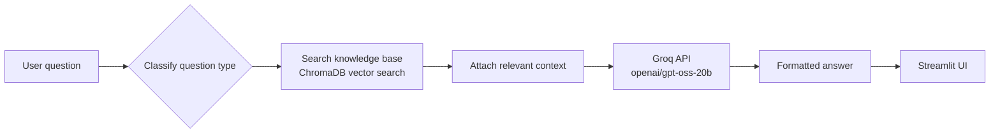
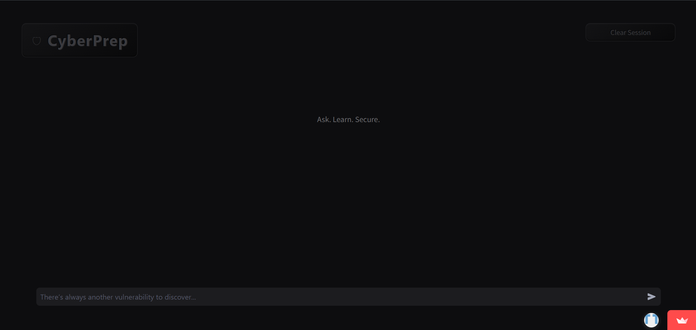
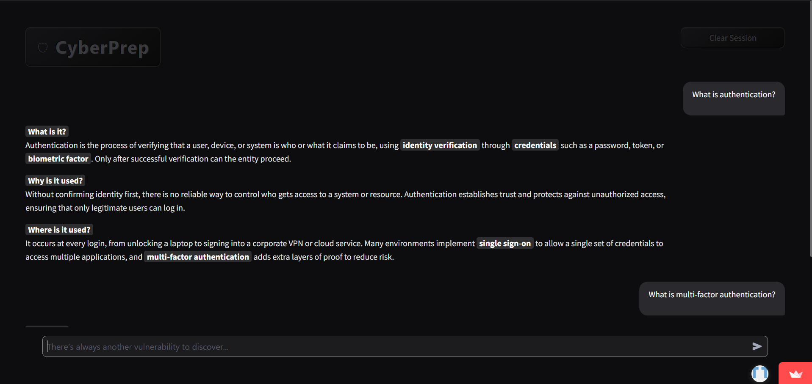
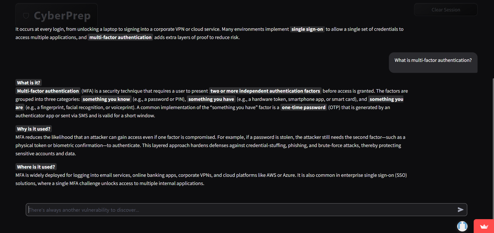
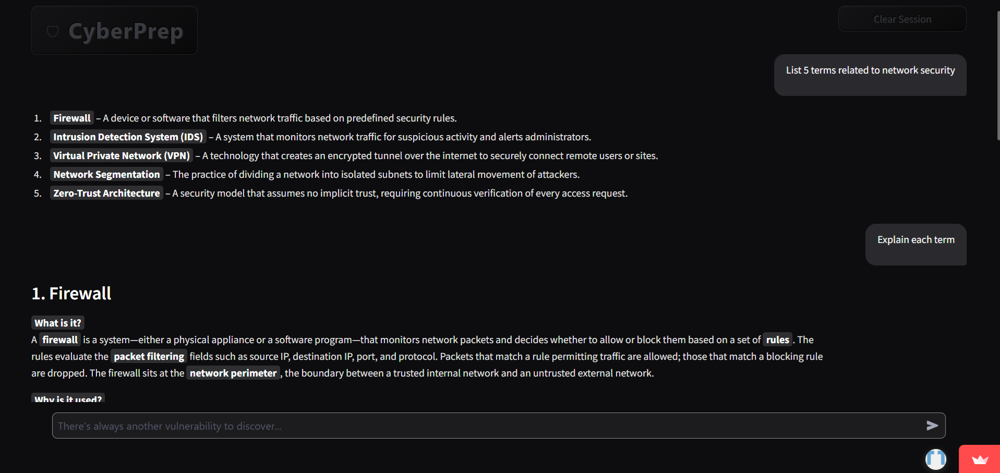
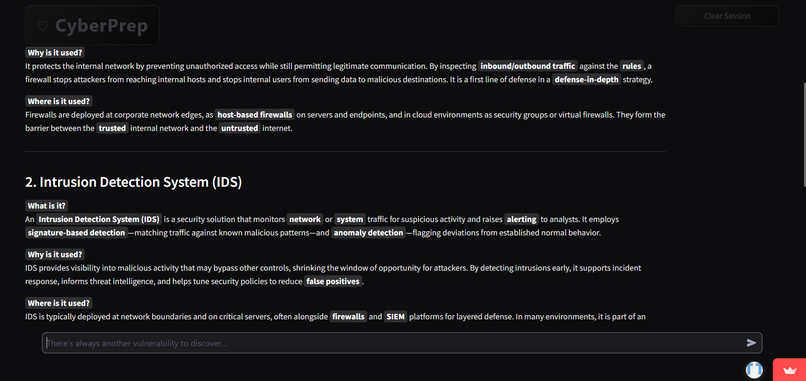
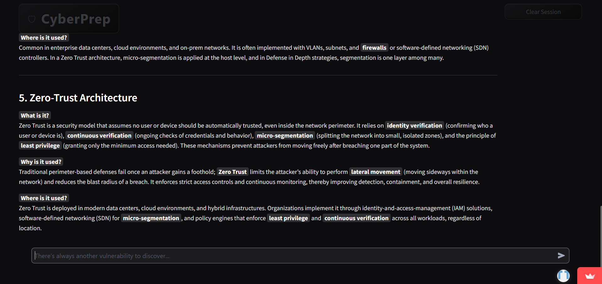
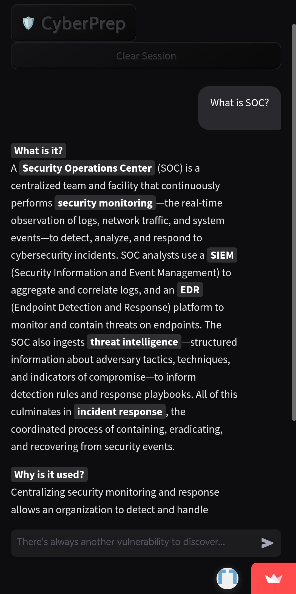

# 🛡️ CyberPrep

**An AI-powered chatbot that helps cybersecurity students explain concepts the way interviewers actually expect to hear them.**

[](https://cyberprep-chatbot-wl3axvvs4zxgpzzt9ecvsu.streamlit.app)
[](LICENSE)
[](https://www.python.org/downloads/)

---

## 🚀 Try it live

**[cyberprep-chatbot-wl3axvvs4zxgpzzt9ecvsu.streamlit.app](https://cyberprep-chatbot-wl3axvvs4zxgpzzt9ecvsu.streamlit.app)**

No installation, no sign-up — just open the link and start asking.

> **Note:** this is hosted on Streamlit Community Cloud's free tier, which puts inactive apps to sleep after a period of no visitors. If the link shows a "Zzzz" wake-up screen, just click the button — it takes about 30 seconds to spin back up.

---

## The problem this solves

A lot of freshers preparing for cybersecurity interviews don't fail because they don't understand the material — they fail because they can't **articulate** it the way an interviewer expects. They explain *around* a concept instead of naming it precisely, or they leave out the exact keywords ("confidentiality," "least privilege," "lateral movement") that signal real understanding.

CyberPrep is a focused study tool built to close that specific gap: ask it about any cybersecurity concept, and it answers in a consistent, interview-ready **What / Why / Where** format, with the technical vocabulary you should actually be saying out loud **bolded** so you can see exactly what to emphasize.

---

## Features

- **Structured explanations** — every concept broken into *What is it? / Why is it used? / Where is it used?*
- **Keyword highlighting** — the exact terms an interviewer listens for are visually called out
- **Grounded in a curated knowledge base** — 56 hand-written, verified glossary entries (not just the model's raw memory), retrieved via semantic search (RAG)
- **Smart question handling** — distinguishes between asking for a definition, a list of terms, a how-to procedure, a tool recommendation, or a natural follow-up — and answers each one appropriately instead of forcing every reply into the same format
- **Multi-term explanations that don't degrade** — ask it to "explain each" of a list of terms, and it processes them individually behind the scenes so quality and formatting stay consistent from the first term to the last, instead of trailing off
- **Conversation memory** — follow-up questions work naturally within a session
- **Custom monochromatic UI** — built from scratch with Streamlit, including mobile-responsive styling

---

## How it works

CyberPrep is a Retrieval-Augmented Generation (RAG) application — instead of relying purely on the underlying language model's training data, it first searches a small, curated knowledge base for relevant, verified content, then uses that to ground its answer.



**Why this matters in practice:** early in development, the model confidently answered a question about the OWASP Top 10 using an outdated 2021 edition, and when corrected, it briefly invented a non-existent "2023" version rather than admitting uncertainty. Adding that specific topic to the grounded knowledge base — and adding an explicit instruction not to fabricate version numbers — fixed it. That's the core value RAG provides here: trustworthy, current answers instead of confident-sounding guesses.

### Tech stack

| Layer | Tool |
|---|---|
| LLM | [Groq](https://groq.com) API, running `openai/gpt-oss-20b` |
| Vector database | [ChromaDB](https://www.trychroma.com/) |
| Frontend | [Streamlit](https://streamlit.io/) |
| Markdown rendering | Python `markdown` library |
| Hosting | Streamlit Community Cloud |

---

## Screenshots

**Starting screen**


**Basic term explanation, with bolded keywords and natural follow-up questions**



**Multi-term explanation — a list of terms, then each explained individually**




**Mobile view**


---

## Getting started locally

Want to run this yourself, or look under the hood? Here's the full setup.

### 1. Clone the repository
```bash
git clone https://github.com/kpabhishek4904/cyberprep-chatbot.git
cd cyberprep-chatbot
```

### 2. Create a virtual environment
```bash
python -m venv venv
venv\Scripts\activate        # Windows
source venv/bin/activate     # macOS/Linux
```

### 3. Install dependencies
```bash
pip install -r requirements.txt
```

### 4. Set up your API key
Get a free API key from [console.groq.com](https://console.groq.com), then:
```bash
cp .env.example .env
```
Open `.env` and paste your key in.

### 5. Build the knowledge base
```bash
python knowledge_base/build_vector_db.py
```

### 6. Run it
```bash
streamlit run streamlit_app.py
```

A command-line version is also available via `python app.py`, useful for quick testing without the full UI.

---

## Project structure

```
cyberprep-chatbot/
├── streamlit_app.py           # Web interface (main entry point)
├── app.py                     # Command-line interface
├── core/
│   ├── chat_engine.py         # Routing, retrieval, multi-term handling
│   ├── prompt_template.py     # The system prompt
│   ├── retriever.py           # Vector database search
│   ├── llm_client_groq.py     # Groq API client
│   └── llm_client_ollama.py   # Local LLM alternative (Ollama)
├── knowledge_base/
│   ├── source_documents/glossary.json   # 56 curated glossary entries
│   ├── build_vector_db.py     # Builds the ChromaDB database
│   └── db_location.py         # Shared database path logic
└── testing/                   # Phase-by-phase test plans and results
```

---

## Testing

This project went through five structured testing phases before deployment — term-by-term accuracy checks against hand-written benchmark answers, RAG grounding verification, adversarial scope testing (trying to get it to answer off-topic questions), and a full glossary-expansion regression pass. The `testing/` folder contains the actual test plans used.

---

## What I learned

- **Prompt engineering is iterative, not one-shot.** Nearly every behavior in this project — bolding consistency, format switching between definitions and how-to answers, refusing off-topic questions gracefully — needed multiple rounds of real testing and rewriting before it held up reliably.
- **RAG is really about trust, not just accuracy.** The most convincing demonstration of this project's value wasn't a clever feature — it was catching the model confidently giving outdated, and then fabricated, information about the OWASP Top 10, and fixing it by grounding that specific fact.
- **Small-scale engineering decisions compound.** Choices like keeping conversation history out of the API call budget (token trimming), or routing multi-term requests through individual API calls instead of one large one, each solved a real problem that only showed up under actual use, not initial testing.
- **Deployment surfaces entirely new categories of bugs.** Everything worked locally; deploying to the cloud immediately surfaced a filesystem permissions issue, a secrets-handling gap, and a privacy consideration (shared conversation persistence) that never would have come up running solo on my own machine.
- **Git/GitHub is its own skill.** Cleaning up accidentally committed IDE cache files, fixing a commit author misconfiguration, and understanding force-pushing safely were all real, practical lessons that came from this project specifically, not just from the chatbot itself.

---

## Known limitations

- **Free-tier hosting constraints** — the app sleeps after inactivity, carries Streamlit's own branding, and may feel slightly slower than local use due to shared compute resources.
- **Knowledge base scope** — 56 terms is a meaningful foundation, not exhaustive coverage of all of cybersecurity. Questions outside this scope fall back to the model's general training knowledge, which may occasionally be outdated (as the OWASP Top 10 example showed).
- **Heuristic multi-term detection** — the system recognizes phrases like "explain each" to trigger per-term processing; sufficiently different phrasing might not be recognized.
- **Approximate token management** — conversation history trimming uses a rough character-based token estimate, not exact tokenization.
- **Rate limits on the free Groq tier** — a very large multi-term request can hit API rate limits; the app handles this gracefully by stopping and reporting partial progress rather than failing silently.

---

## License

This project is licensed under the [MIT License](LICENSE).
